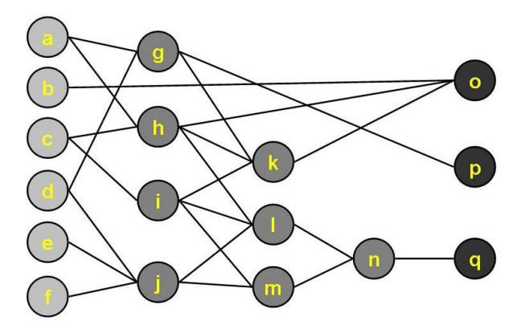

# CAD Design Project 4 – Resource-Constrained Scheduling

**Due: 23:59, Nov. 25, 2026**

In this project, you are required to implement two versions of scheduling algorithms for minimizing the latency under given resource constraints (ML-RCS). (1) A heuristic algorithm (ex: list scheduling). (2) Based on the result of your heuristic algorithm, formulate the same problem as an integer linear programming (ILP) problem and use an ILP solver (ex: Gurobi) to obtain the exact result. Your program will be evaluated in a Linux environment (e.g., WSL) according to the following requirements.

1. For simplicity, there are only 3 types of Boolean operations: *AND*, *OR*, and *NOT*.
2. Assume that every operation takes 1-cycle latency. (The PI node is not an operation.)
3. Read a BLIF file and the corresponding resource constraints.
4. Use options "-h" and "-e" for the heuristic and the exact formulation, respectively.
5. Generate your own test case for which your heuristic algorithm and ILP-based method produce different latencies.
6. Submit a research report as a single PDF of at most 3 pages, including figures and tables. Explain your heuristic scheduling algorithm and ILP formulation, including how precedence and resource constraints are enforced and how the heuristic result is used in the ILP model. Support your design choices and improvements during development with analysis, experimental evidence, and trade-offs. Compare the latency and runtime of both methods on the same inputs under identical resource constraints. Analyze the test case with different latencies, explain the causes of the discrepancy, and discuss the strengths and limitations of your heuristic. A GUI, auxiliary analysis tools, or your own special features are highly encouraged.
7. Upload a tarball (\*.tgz) of your C/C++ program source code and a text ReadMe file, which illustrates how your program is to be compiled and executed in a Linux environment.

(NOTE: The uploaded file name should be the same as your student ID.)


BLIF Example: `sample02.blif`（與 `benchmark/aoi_sample02.blif` 相同）



```
.model sample02
.inputs a b c d e f
.outputs o p q
.names a d g
1- 1
-1 1
.names a c h
11 1
.names c i
0 1
.names d e f j
1-- 1
-1- 1
--1 1
.names g h i k
1-- 1
-1- 1
--1 1
.names h i j l
111 1
.names i j m
11 1
.names l m n
11 1
.names b h k o
111 1
.names g p
0 1
.names n q
0 1
.end
```

SYNOPSIS for ML-RCS

```
%> mlrcs -h/-e BLIF_FILE AND_CONSTRAINT OR_CONSTRAINT NOT_CONSTRAINT
```

Run-time Example:

```
%> mlrcs -h sample02.blif 2 1 1
Heuristic Scheduling Result
1: {h} {j} {i}
2: {l m} {g} {}
3: {n} {k} {p}
4: {o} {} {q}
LATENCY: 4
END
```

Run-time Example:

```
%> mlrcs -e sample02.blif 2 1 1
ILP-based Scheduling Result
1: {h} {j} {i}
2: {l m} {g} {}
3: {n} {k} {p}
4: {o} {} {q}
LATENCY: 4
END
```